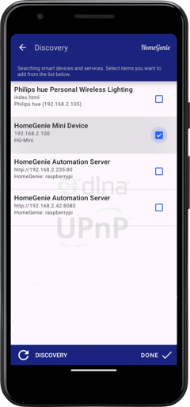

# HomeGenie Mini v1.2 <small>`ESP32 / ESP8266`</small>

HomeGenie Mini is an **open source library** for building custom firmware for smart devices based on *ESP32* or *ESP8266* SoC. It allows you to create fully independent smart devices with local logic, cloud-free operation, and built-in JavaScript automation.

https://homegenie.it/mini

<p align="center">
  <a href="https://deepwiki.com/genielabs/homegenie-mini"></a>
</p>

## Features

- **Easy web-based installation** directly from your browser (via Web Serial API)
- Easy device configuration using Wi-Fi protected setup button (WPS) or Bluetooth
- Does not require an Internet connection to be configured or to work properly
- Time synchronization using internal RTC (ESP32), mobile app time or NTP
- Integrated actions scheduler supporting *extended Cron expressions* and JavaScript
- Device discovery via SSDP/UPnP with customizable device name
- Multichannel I/O: HTTP, WebSocket, SSE, MQTT, Serial
- Built-in status LED logic and GPIO control API
- Multi-threading support, event router, extensible API
- Direct connection to *HomeGenie Panel* (Wi-Fi AP, hotspot or local network)
- Seamless integration with *HomeGenie Server* and other services via MQTT

---

## Installation & Flashing

Depending on your preference, you can flash the firmware either directly from your browser or compile it manually using the CLI.

### Method 1: Web Installer (Recommended & Code-Free)
If you prefer a quick, visual setup without installing coding tools, you can upload pre-compiled firmwares directly from the browser:
1. Connect your ESP device to your computer via USB.
2. Open the [HomeGenie Mini Getting Started Page](https://homegenie.it/mini/1.2/getting-started/).
3. Use the **Firmware Upload form** at the bottom of the page: select your SoC model, enter your Wi-Fi credentials (optional), and click **Create device**.

### Method 2: PlatformIO CLI (For Developers)
To customize and compile the firmware from source code, install [Platform.IO core](https://docs.platformio.org/en/latest/installation.html) and download the [HomeGenie Mini source code](https://github.com/genielabs/homegenie-mini/releases).

Open a terminal in the project directory and run the following commands to install the required dependencies:

```bash
pio pkg update
pio pkg install
```

To build and upload the default firmware to your connected ESP device, run:

```bash
pio run -e default -t upload
```

---

## Configuration Environments

The `-e default` option builds the base firmware for a generic *ESP32* board.

To list all available configurations (including specific profiles for target devices), run:

```bash
pio project config
```

You can customize environments or define your own pin mappings and features by editing the `platformio.ini` file.

---

## Pre-built Firmware Projects (Examples)

HomeGenie Mini provides several specialized configurations and ready-to-use firmware templates. You can find detailed guides, 3D printing files, and schematics on the official website:

- 📺 [**Smart Display & Control**](https://homegenie.it/mini/1.2/smart-display-control/): Transforms an ESP32 with a TFT touch display into a local smart dashboard using LVGL or LovyanGFX.
- 🤖 [**Smart Car & Robotic Arm**](https://homegenie.it/mini/1.2/robotic-arm/): Configures multi-servo motor control (`smart-motor` firmware) for DIY robotics and Mecanum wheels.
- 📷 [**Smart Camera + A.I.**](https://homegenie.it/mini/1.2/smart-camera-ai/): Implements video streaming and object tracking logic using ESP32-CAM models.
- 💡 [**Smart Light / Mood Lamp**](https://homegenie.it/mini/1.2/smart-light/): Controls WS281x RGB LED strips with automated transitions, schedules, and custom animations.
- 🌡️ [**Smart Sensor**](https://homegenie.it/mini/1.2/smart-sensor/): Gathers data from DHT22, LDR, and motion sensors with low overhead.
- 📟 [**Remote Control & Gateway**](https://homegenie.it/mini/1.2/remote-control/): A multi-protocol transceiver gateway (Firefly Kit) to capture, replay, and bridge IR, generic 433/315 MHz RF (SYN modules or CC1101 SPI), and bidirectional **X10 RF** home automation devices.

---

## Connecting the Device

Once the firmware is installed, the status LED will blink continuously, indicating the device is not yet connected to a network. You can connect it using one of these methods:

### 1. Via Web Installer (Quickest)
If you flashed your device using the browser-based Web Installer, you can pre-configure the Wi-Fi credentials. If you need to update them later, enter the new credentials, check **"Initialize only"** on the upload form, and click **Create device** to write only the configuration parameters without re-flashing the firmware.

### 2. Via WPS (Wi-Fi Protected Setup)
1. Enable WPS on your router.
2. Press and hold the WPS button on your ESP device (often labeled as `BOOT` or `B`) for at least 5 seconds.
3. The LED will turn solid while pairing, blink quickly for 5 seconds when connected, and then switch to a slow, steady pulse.

### 3. Via Bluetooth (HomeGenie Panel)
1. Turn on Bluetooth on your smartphone and open the [HomeGenie Panel](https://play.google.com/store/apps/details?id=com.glabs.homegenieplus) app.
2. Go to the connection discovery page. The app will detect the new device over Bluetooth and open a setup wizard to configure the device name and Wi-Fi credentials.

Once connected, your device will appear in the HomeGenie Panel dashboard.



### Connecting to HomeGenie Server

HomeGenie Mini devices feature zero-configuration network discovery and seamless integration with [HomeGenie Server](https://github.com/genielabs/HomeGenie):

1. **Automatic Discovery (UPnP/SSDP):**  
   Once connected to your local Wi-Fi network, your HomeGenie Mini device is automatically detected by HomeGenie Server and appears as a device card in the **UPnP** dashboard group.

2. **One-Click MQTT Connection:**  
   Click the **`CONNECT`** button on the device card. HomeGenie Server will automatically provision and establish the secure MQTT communication link in the background&mdash;no manual broker configuration required.

3. **Browse Modules & Add Dashboard Widgets:**  
   Once connected, click the **`MODULES`** button to view all hardware endpoints exposed by the device (e.g., *IR Transceiver*, *RC RF*, *Color Light*, *X10 Devices*). From the popup dialog, you can select any module and add its interactive widget directly to your preferred dashboard groups.

---

## Monitoring and Serial Commands

To monitor logs and interact with the device via the serial interface, connect your device to your USB port and run:

```bash
pio device monitor -b 115200
```

### Serial Configuration Commands

You can configure the device or query its status directly from the serial terminal. Enter system commands prefixed by `#` or use `/api/` prefix for API commands.

#### Core Commands
- `#CONFIG:device-name <name>`
- `#CONFIG:wifi-ssid <ssid>`
- `#CONFIG:wifi-password <passwd>`
- `#VERSION` / `#RESET` / `#UPTIME` / `#WPS`

#### Get/Set Parameters
- `#GET:<parameter_key>`
- `#SET:<parameter_key> <value>`

| Key        | Description                                    | Default          |
|------------|------------------------------------------------|------------------|
| `sys-rb-n` | Factory reset button GPIO#                     | -1 (disabled)    |
| `sys-sl-n` | System status LED GPIO#                        | -1 (disabled)    |
| `io-typ01` | I/O Ch.1 type ('Switch', 'Light', 'Dimmer')     |                  |
| `io-pin01` | I/O Ch.1 GPIO#                                 | -1 (disabled)    |

*Example setting status LED and reset button:*
```text
#SET:sys-sl-n=10
#SET:sys-rb-n=0
#RESET
```

---

# Disclaimer

<small><code>
THIS PROJECT IS PROVIDED BY THE COPYRIGHT HOLDERS AND CONTRIBUTORS "AS IS" AND ANY EXPRESS OR IMPLIED WARRANTIES, INCLUDING, BUT NOT LIMITED TO, THE IMPLIED WARRANTIES OF MERCHANTABILITY AND FITNESS FOR A PARTICULAR PURPOSE ARE DISCLAIMED. IN NO EVENT SHALL THE COPYRIGHT OWNER OR CONTRIBUTORS BE LIABLE FOR ANY DIRECT, INDIRECT, INCIDENTAL, SPECIAL, EXEMPLARY, OR CONSEQUENTIAL DAMAGES (INCLUDING, BUT NOT LIMITED TO, PROCUREMENT OF SUBSTITUTE GOODS OR SERVICES; LOSS OF USE, DATA, OR PROFITS; OR BUSINESS INTERRUPTION) HOWEVER CAUSED AND ON ANY THEORY OF LIABILITY, WHETHER IN CONTRACT, STRICT LIABILITY, OR TORT (INCLUDING NEGLIGENCE OR OTHERWISE) ARISING IN ANY WAY OUT OF THE USE OF THIS PROJECT, EVEN IF ADVISED OF THE POSSIBILITY OF SUCH DAMAGE.
</code></small>